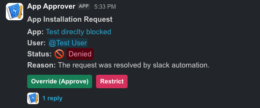
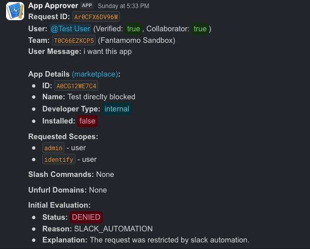
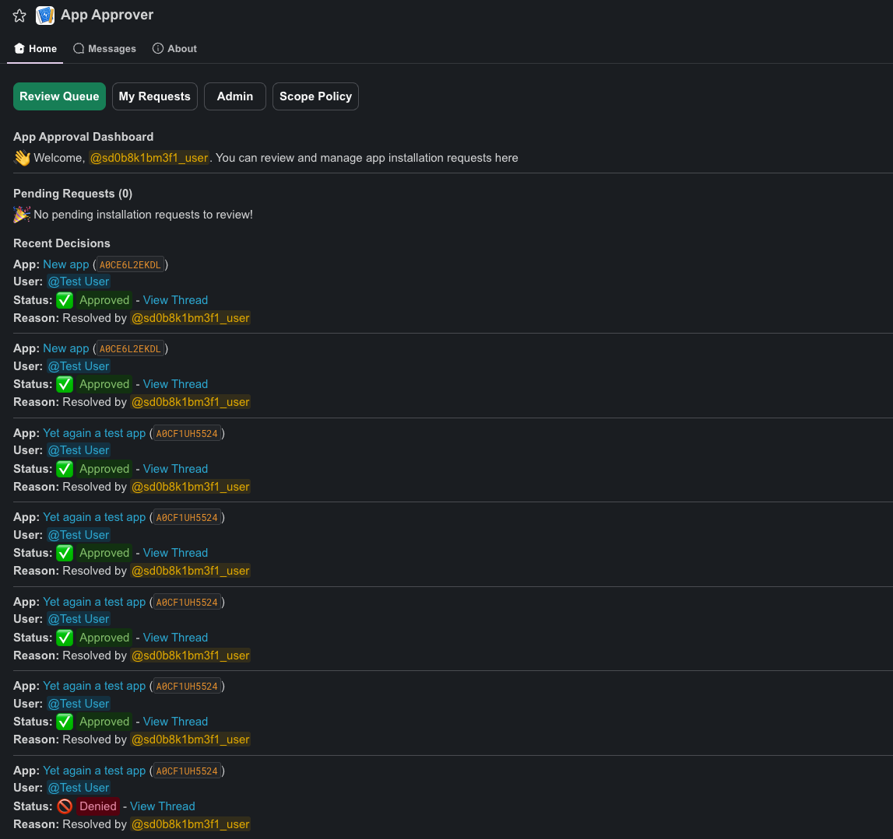
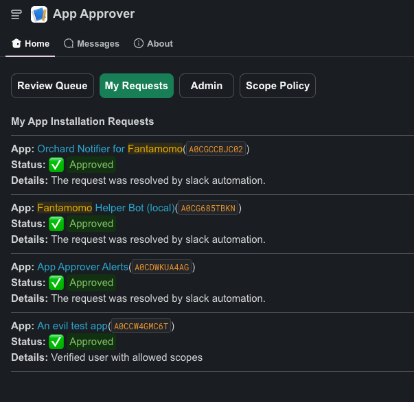
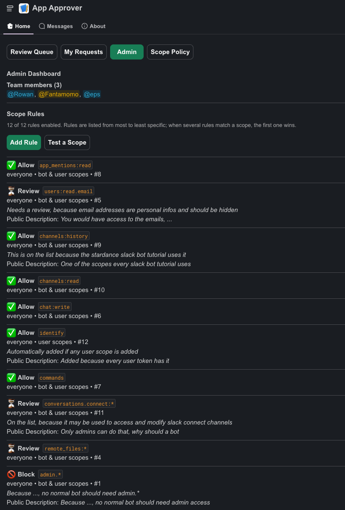

# Appetizer

> Originally created by [Fantamomo](https://github.com/Fantamomo) as [app-approver](https://github.com/Fantamomo/app-approver).

This is a Slack bot that handles the request approval process for a Slack organization.

## Installation

Create a new Slack app using the [`manifest.json`](manifest.json), disable Socket Mode and read [HTTP API](#http-api) for more information.

Then install the app to your **Slack Enterprise Organization**, not to a single workspace. You need to be an organization admin/owner.

We recommend using a new admin account for this, so that all actions are performed under this account. And not yours.

Start the program. On the first run, it will automatically generate a `config.properties` file containing all available configuration options.

### Configuration

The configuration file can be specified using the `CONFIG_FILE_PATH` environment variable. If it is not set, `config.properties` in the current working directory is used.

| Config                 | Description                                                                                      | Required | Default                                      | Environment Variable   |
|------------------------|--------------------------------------------------------------------------------------------------|---------:|----------------------------------------------|------------------------|
| `server.port`          | The port the HTTP server should listen on.                                                       |       No | `80`                                         | `SERVER_PORT`          |
| `server.host`          | The host/interface the server should bind to.                                                    |       No | `0.0.0.0`                                    | `SERVER_HOST`          |
| `postgres.url`         | The R2DBC URL of the PostgreSQL database.                                                        |       No | `r2dbc:postgresql://localhost:5432/postgres` | `POSTGRES_URL`         |
| `postgres.user`        | The username for the PostgreSQL database.                                                        |       No | `postgres`                                   | `POSTGRES_USER`        |
| `postgres.password`    | The password for the PostgreSQL database.                                                        |       No | `postgres`                                   | `POSTGRES_PASSWORD`    |
| `slack.bot.token`      | The Slack bot token.                                                                             |  **Yes** | —                                            | `SLACK_BOT_TOKEN`      |
| `slack.user.token`     | The Slack user token.                                                                            |  **Yes** | —                                            | `SLACK_USER_TOKEN`     |
| `slack.app.token`      | The Slack app token used for Socket Mode.                                                        |       No | Empty                                        | `SLACK_APP_TOKEN`      |
| `slack.client.token`   | The Slack client token required for command checking.                                            |       No | Empty                                        | `SLACK_CLIENT_TOKEN`   |
| `slack.session.cookie` | The Slack session cookie starting with `xoxd-` (cookie name `d`), required for command checking. |       No | Empty                                        | `SLACK_SESSION_COOKIE` |
| `signing.secret`       | The Slack Signing Secret to verify requests from slack in HTTP Mode                              |       No | Empty                                        | `SIGNING_SECRET`       |
| `slack.channel.review` | The Slack channel used for reviews.                                                              |  **Yes** | —                                            | `SLACK_CHANNEL_REVIEW` |
| `slack.channel.log`    | The Slack channel used for review logs.                                                          |  **Yes** | —                                            | `SLACK_CHANNEL_LOG`    |
| `socket.mode`          | Whether to use Slack Socket Mode instead of the HTTP API. (**not recommended**)                  |       No | `false`                                      | `SOCKET_MODE`          |
| `admin.users`          | Comma Seperated List of users (starting with U) that can execute the command                     |       No | —                                            | `ADMIN_USERS`          |
| `slack.slash.command`  | Must be the same as the command you registered in Slack/Manifest (starting with /)               |       No | `/app-approver`                              | `SLACK_SLASH_COMMAND`  |
| `allow.approving.own`  | Whether to allow team members to approve there own requests                                      |       No | `true`                                       | `ALLOW_APPROVING_OWN`  |

> If **any** environment variable is provided, the program will **not** create the `config.properties` file (but it is still **read**).

### Running with Docker & Docker Compose

#### Using Docker Compose (Recommended)

1. Copy the sample environment file and fill in your Slack and database credentials:
   ```bash
   cp .env.example .env
   ```
2. Build and start the bot and PostgreSQL services:
   ```bash
   docker compose up -d
   ```

#### Using Docker directly

1. Build the Docker image:
   ```bash
   docker build -t bot-approver .
   ```
2. Run the container:
   ```bash
   docker run -d \
     --name bot-approver \
     -p 80:80 \
     -e POSTGRES_URL="r2dbc:postgresql://host.docker.internal:5432/bot_approver" \
     -e POSTGRES_USER="bot_approver" \
     -e POSTGRES_PASSWORD="secretpassword" \
     -e SLACK_BOT_TOKEN="xoxb-..." \
     -e SLACK_USER_TOKEN="xoxp-..." \
     -e SLACK_CHANNEL_REVIEW="C12345678" \
     -e SLACK_CHANNEL_LOG="C87654321" \
     bot-approver
   ```

### Managing restrictions and team members

Restrictions and team members can be managed with the `/app-approver` command. To execute the command, your user id must be in the `admin.users` list.

#### Scopes

While it is still possible to set and change the scopes via the `/app-approver` command, it is not recommend and now deprecated.

If you still want to use it, open the git history and find the lines, which are now deleted.

But there is a better system. Open the App Home and go to `Admin` (you need to be on the `admin.users` list).
There you have a much nicer UI for all the scopes. It is pretty self explaining, but you can add scopes via the `Add scope` button.

**Behavior**

- `allow`: Allows the scope for verified users. Is the default. So you only need to specify this if you restricted a pattern in which the scope would be rejected.
- `allow-unverified`: Allows the scope for unverified users.
- `restrict`: Restricts the scope for all users.
- `reset`: Removes the scope from the database. Leaving type out or using `BOTH` ignores the type and removes all entries for the scope.

#### Team Members

| Command                | Description                    |
|------------------------|--------------------------------|
| `team`                 | Shows all team members         |
| `team add <user>`      | Adds a user to the team        |
| `team remove <user>`   | Removes a user from the team   |

`<user>` can be a user id like `U0123456789` or a mention like `@user`.

Team members can review requests (approve, deny, restrict and undo). They are not allowed to use the slash command, only the configuration admins.

### HTTP API

Slack payloads are received through the HTTP endpoint:

```text
/slack/events
```

Set in your Slack app the **Request URL** of `events`, `commands` and `interactions` to `<your-domain>/slack/events`,
all of them need to point to this url, if they don't, parts of the application will not work.

> We do theoretically support Socket Mode, but we do not recommend it, as it was only implemented for development purposes and not tested in production.

## Approval Flow

When a request is received, the bot checks the following to determinate if the request is valid and should be approved or rejected.

1. **Restricted**: If the application is restricted, the request is <u>rejected</u>.
2. **Enterprise Installation**: If the request is for the entier org, the request is <u>rejected</u>.
3. **Previous denied request**: If the request was previously denied, and nothing changed, the request is also <u>rejected</u>. (Do avoid spam)
4. **Scope evaluation**: All the scopes are checked against the restricted scopes:
    - If there is any no reviewable scope, the request is <u>rejected</u>.
    - If there is any reviewable scope, the request needs to be <u>manually reviewed</u>.
    - If the user is **not** verified and the request does not only contain scopes that are **allowed** for **unverified users**, the request is <u>rejected</u>.
5. **Previous approved scopes**: But hold on, let's review the previous approved scopes first. (Only relevant if the app has been approved before)
    - If the previous approved scopes contained any restricted scopes, and this request does not add any **new** restricted scopes, the request is <u>approved</u>.
    - If this request adds any new restricted scopes, the request is <u>rejected</u> or <u>reviewed</u> within the **above rules**.

## Rejecting

I talked a lot about rejecting requests above. Actually, the request is not rejected, we mark it like that, but on the slack side, it is still pending review.  

This is used because of how slack works:  
When a member requests an app, a request is created with the pending status.    
If we automatically approve it, we tell Slack that it is approved.  
But if the automation rejects it, we don't tell slack that it is rejected. This is necessary to allow the team to override the decision.

**New Problem**: A user cannot send a new request if they have a pending request. So there is a button to withdraw the request, which cancels the request on Slack's side, so the user can send a new request.

But there is also a **Request Manual Review** button, which only changes our status to pending review and updates the thread.

**That's the reason why we don't directly tell slack that the request is rejected.**

## Reviewing

Every request that is sent creates a new thread in the review channel, even if it is rejected or approved automatically.

The reason behind this is to allow the reviewer to override the automation decision. Also, in the thread all the actions are visible.

## Restricting

The review team can restrict an app. That means that the app can never be requested again. Slack will block every try to install it again.

> Only use this if absolutely necessary. (You can still undo it later)

## Status

The status of your requests can be viewed in the App Home of the installed app if you are not a team member.
If you are a team member, you can view all pending requests in the App Home and the last decisions made.

The Bot also DMs the user about the status of their request. And why it was rejected.

There is also a public LOG channel where all requests are logged.

## Why do we need this?

Well so that not everyone can create apps with every scope (some of them can be badly abused)

Want to lean more, here is a [meta thread](https://hackclub.slack.com/archives/C0188CY57PZ/p1790946067527679).

## I want to see this in action!

Yeah sure, you can set it up yourself if you have an enterprise org or a developer sandbox. Or if you are a Hack Clubber and on Slack then [here](https://slack.com/app_redirect?app=A0CD76JJKU6) (only for 13-19y).

Or you could just look at those screenshots:

  
The top level message which some basic infos

  
The message after the top level one to explain more about the request

  
The App Home Team Screen

  
All the requests I have done


The admin home screen, where you can see all team members and all rules for scopes